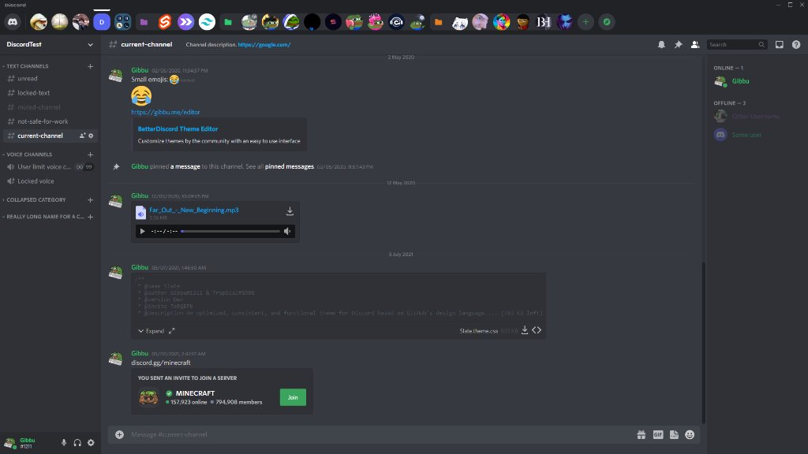

# 🌸 horizontal server list (neko edition) 🌸

moves the discord server list from the left side to the top (or bottom!) bc having it on the left makes my brain hurt, and discord updated and broke everything so i had to panic fix it ;w;

---

### ✨ features ✨
- 🖥️ put server bar up top OR at the very bottom so discord looks pretty
- 🧭 discover compass icon actually faces the right way now (it was tilted and i almost had a meltdown)
- 📁 folders and notification badges dont do weird backflips anymore
- 🩹 patched for the new discord subgrid update thingy that ruined my entire life
- 🎀 100% certified girlfailure code (pls do NOT inspect element)

---

### 📦 how to use (vencord)

pick whichever version u like better:
- **top version**: copy `HorizontalServerList.theme.css` into ur vencord themes folder
- **bottom version**: copy `HorizontalServerListBottom.theme.css` into ur vencord themes folder (or use `src/addons/bottomhsl.css` if u prefer addons!)

1. put ur chosen `.theme.css` file into:
   `%AppData%\Vencord\themes\`
2. enable it in vencord settings under **Themes**
3. press `ctrl + r` on discord to reload
4. pray to whatever god u believe in that discord doesnt push an update tomorrow and break it all over again ;-;

---

### 💖 credits & stuff
- originally based off [DiscordStyles/HorizontalServerList: Moves the server list from the left to the top of Discord.](https://github.com/DiscordStyles/HorizontalServerList) by Gibbu!
- patched and duct-taped together by **nekolessi** so it actually works on recent discord updates :3
